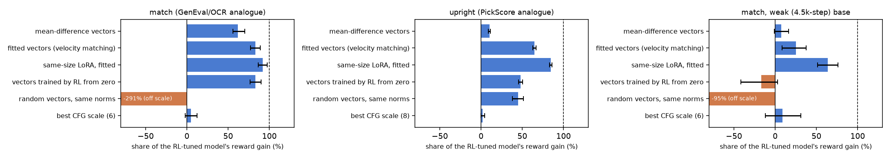
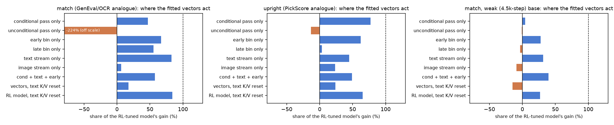
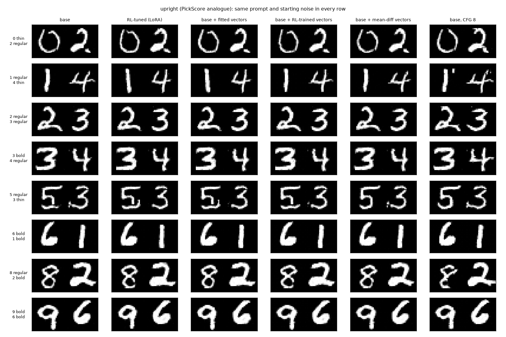

# just-a-nudge

**Is RL post-training of a diffusion transformer just a constant nudge to its activations?** A recent paper
says yes: on SD3.5, FLUX and Wan, 90-96% of what Flow-GRPO adds comes back from fewer than 200 constant
vectors added to the frozen base model's block outputs. This repo rebuilds that experiment from nothing
(a 3.45M-parameter MM-DiT, MNIST, Flow-GRPO, a laptop GPU) to see whether the claim survives at a scale anyone
can rerun in a couple of hours.

**Short answer: mostly, for prompt following; partly, for style.** 5,632 constant numbers (51x fewer than the
RL LoRA) recover **83%** of what RL taught the model about binding stroke weights to digits, and RL that trains
*only* those numbers gets the same 83%. For a slant-correcting "aesthetic" reward they recover **65%**, and a
LoRA with the same parameter count does clearly better (84%). So the paper's direction holds, but at this
scale part of the RL gain needs an input-dependent change, and the RL-tuned model does not route its gain the
way the vectors do.



This repo is a from-scratch, laptop-scale test of *RL Post-Training in Diffusion Transformers Is Activation
Steering* (Meral, Oktay, Helbling, Kara, Chau & Yanardag, [arXiv 2611.26627](https://arxiv.org/abs/2611.26627),
Nov 2026). The paper's code was listed as "coming soon" when this was written, so everything here, from the
model to the RL loop, is a re-implementation from the paper's text.

## The setup

| | the paper | this repo |
|---|---|---|
| base model | SD3.5-M, FLUX.1-dev, Wan2.1/2.2 (MM-DiT) | 3.45M-param MM-DiT: 6 blocks, width 128, text + image streams, joint attention, adaLN-Zero, last block context-pre-only |
| data | web-scale | two MNIST digits side by side; the prompt names each digit and a stroke weight ("3 bold, 7 thin"); 900 prompts |
| verifiable reward | OCR, GenEval | **match**: classifier p(digit) times a soft check that the digit's ink is in the prompted tercile of its class |
| preference reward | PickScore, HPS | **upright**: minus the mean absolute slant (moment shear mu11/mu02); ignores the prompt, and no tone curve can change it |
| RL | Flow-GRPO, LoRA r=32 (SD3.5) | Flow-GRPO, LoRA r=32 on attention, 300 updates x 128 samples, group 8, KL 0.04, eta 0.7, 10 SDE steps |
| steering vectors | per block output x stream x pass x 2 step bins | the same: 11 block outputs x 2 passes x 2 bins = 44 vectors, 5,632 numbers |
| sampler | 40 steps, CFG 4.5 | 20 Euler steps, CFG 4.5, step-bin boundary halfway |
| evaluation | held-out prompts, paired, bootstrap | 150 held-out prompts x 8 seeds, the same noise for every policy, 2,000 prompt-level bootstrap resamples |

RL and vector fitting see only the 750 training prompts. Every number below is on the 150 held-out ones.

## Results

`share` = (reward of the policy - reward of the base) / (reward of the RL-tuned model - reward of the base),
which is the paper's "recovery". Brackets are 95% bootstrap intervals over prompts. All numbers come from
[`results/tables.md`](results/tables.md), which `scripts/04_report.py` writes from the result JSONs.

| | **match** (GenEval/OCR analogue) | **upright** (PickScore analogue) | paper, image models |
|---|---|---|---|
| base -> RL-tuned reward | 0.910 -> 0.956 (+0.046) | -0.174 -> -0.065 (+0.109) | |
| exact prompt match (classifier B + weights), base -> RL | 90.8% -> 98.5% | 90.8% -> 92.6% | |
| **fitted vectors (velocity matching, Eq. 2)** | **83.0% [76.9, 89.1]** | **64.7% [62.6, 66.8]** | 90.0-96.3% |
| **vectors trained by Flow-GRPO from zero** | **82.9% [76.8, 90.0]** | **47.9% [45.6, 50.2]** | 103.6-104.6% |
| mean-difference vectors (s_mean) | 61.9% [55.7, 70.3] | 10.2% [9.0, 11.5] | 12.2-79.0% |
| LoRA with the same parameter count, fitted the same way | 91.8% [86.4, 97.3] | 84.4% [82.9, 85.8] | 89.5-97.4% (no detected difference) |
| random vectors with the fitted norms | -291% | +45% (but exact match falls to 48%) | PickScore falls by 4.7 |
| best CFG scale on the base (1-8) | 5.0% | 2.1% | CFG 6-7.5: 0-12% |
| parameters, vectors vs RL LoRA | 5,632 vs 286,720 (51x) | the same | 0.29M vs 18.8M (65x) |
| velocity gap closed, cond / uncond pass | 0.62 / 0.73 | 0.64 / 0.68 | |

**What reproduced.**

- **A handful of constant vectors carries most of a prompt-following gain.** On match, the fitted vectors raise
  exact prompt accuracy from 90.8% to 97.6% (RL: 98.5%) with no reward in the loop, and Flow-GRPO that trains
  only the vectors reaches 97.8%. The change is prompt-dependent (thin digits must get thinner, bold ones
  bolder), yet the vectors are not: they act on the text tokens, and the text tokens carry the prompt.
- **It is not guidance and not noise.** No CFG scale from 1 to 8 gives more than 5% of the gain, and random
  vectors with the same norms wreck the samples (match share -291%).
- **Fitting beats averaging.** The mean-difference vectors recover 62% and 10%, inside the paper's range (12-79%).
- **The passes and step bins behave as in the paper.** Unconditional-pass vectors alone *hurt* (-224% and -13%;
  the paper's Table S12 has the same sign), and for upright the early bin carries the gain (62%) while the late
  bin carries almost none (3%). The conditional and unconditional vectors point the same way (mean cosine
  0.74-0.76), which is the paper's explanation for why dropping the unconditional ones can help: on upright,
  conditional-only recovers 77%, more than the full set (65%).
- **The vectors reach the image through joint attention.** Resetting the text keys and values that image queries
  read to the unsteered base's leaves 17.5% (match) and 23.9% (upright) of the vectors' gain; the paper reports
  20.5% and 10.5%. On match, text-stream vectors alone give 82.8% and image-stream vectors alone 6.3%.

**What did not reproduce.**

- **Recovery is lower than the paper's**: 83% and 65% against 90-96%, and RL on the vectors alone reaches 48% on
  upright against the paper's 104%.
- **The same-size LoRA wins.** Fitted with the same loss on the same data, a rank-2 LoRA on the attention output
  projections (exactly 5,632 parameters) recovers 92% and 84%; for upright the intervals do not overlap. The
  paper found no detected difference on image models. Here part of the RL gain needs an input-dependent change,
  most clearly for upright: straightening a digit is a per-sample correction (a left-leaning 7 needs the opposite
  shear of a right-leaning one), even though the reward itself ignores the prompt.
- **The RL-tuned model does not use the route the vectors use.** The same text-K/V reset leaves the RL-tuned
  model 84% (match) and 65% (upright) of its own gain, against the paper's 24-26%. The vectors reproduce RL's
  output through the text stream, while the RL LoRA gets there mostly through the image stream. That fits the
  paper's own caveat ("we make no claim of necessity"), but not its finding that RL-tuned models also depend on
  the text keys and values.
- Conditional-pass-only does not beat the full set on match (47% vs 83%).



| fitted vectors kept (share %) | match | upright | paper, OCR / PickScore (Table S12) |
|---|---|---|---|
| conditional pass only | 46.7 | 77.3 | 100 / 96 |
| unconditional pass only | -223.7 | -13.4 | -13 / -86 |
| early bin only | 66.9 | 62.1 | 90 / 74 |
| late bin only | 55.5 | 3.4 | 13 / 16 |
| text stream only | 82.8 | 44.6 | 74 / 84 |
| image stream only | 6.3 | 23.5 | 38 / 1 |
| blocks 0-2 / blocks 3-5 | 77.7 / -29.5 | 51.1 / 20.1 | |
| all, with the text K/V read by image queries reset | 17.5 | 23.9 | 20.5 / 10.5 |
| RL-tuned model, same reset | 83.8 | 65.2 | 26.4 / 24.5 |

The paper's column converts its Table S12 gains into shares of its RL gains (+0.344 OCR, +1.560 PickScore).

### Side effects

RL on one reward barely moves the other, and neither do the vectors fitted to it. On the match run the upright
reward changes by less than 0.001 for the RL model, the fitted vectors and the RL-trained vectors. On the upright
run exact match moves by +1.8 points (RL), +1.4 (fitted vectors) and -1.8 (RL-trained vectors). The random-vector
control is the exception: it "improves" upright by 45% of RL's gain by smearing digits into thicker, rounder
shapes (ink +11%), and exact prompt accuracy collapses from 90.8% to 47.6%. The upright reward can be gamed by
distortion; the fitted and RL-trained vectors do not do that.



The same prompt and starting noise run across each row of the upright run. Columns: base, RL-tuned LoRA, base +
fitted vectors, base + RL-trained vectors, base + mean-difference vectors, base at CFG 8. The match run's grid is
[`figures/match_grid.png`](figures/match_grid.png), and the RL training curves are in
[`figures/rl_curves.png`](figures/rl_curves.png).

### Two variants

| share of the RL gain (95% CI) | match, **weak base** (4,500 steps) | upright, **no KL** |
|---|---|---|
| base -> RL-tuned reward | 0.312 -> 0.347 (+0.036) | -0.174 -> -0.018 (+0.156) |
| exact prompt match, base -> RL | 7.7% -> 10.2% | 90.8% -> **40.7%** |
| fitted vectors | 25.1% [8.2, 37.7] | 82.9% [81.5, 84.3] |
| vectors trained by Flow-GRPO from zero | -16.9% [-41.6, 3.1] | 89.4% [88.4, 90.4] |
| same-size LoRA, fitted | 63.9% [51.3, 75.9] | 93.7% [92.8, 94.5] |
| random vectors, same norms | -94.9% | 74.1% (legibility falls to 21%) |

- **Weak base: where the capability is missing, the nudge fails.** On a base that draws the right digit only 59%
  of the time, the same RL budget adds little (+0.036), and constant vectors recover a quarter of it while
  RL on the vectors alone recovers nothing. This fits the paper's reading that RL steers the generator toward
  what it can already do, though the RL gain here is small.
- **No KL: recovery rises, because the gain becomes a hack.** Without the KL term, RL straightens digits much
  further but wrecks prompt following (exact match 90.8% -> 40.7%). The vectors now recover 83-89% (the
  paper's no-KL PickScore row: 95.2%), but random vectors also get 74% by destroying the digits, so a high share
  on a hacked reward says little.


## Things this toy had to get right

- **The base must leave room for RL.** Pretrained for 20k steps, the base gets 99.8% of held-out prompts exactly
  right at CFG 4.5, and an earlier digits-only version was at 99.99% legibility: nothing left for RL to do. The
  shipped base is a separate 6,000-step run (same recipe, learning rate decayed to 10% by the end) at 91.5%.
  Headroom is not smooth in training length:

  | pretraining steps (learning rate fully decayed) | 2,000 | 3,000 | 4,500 | **6,000** | 20,000 |
  |---|---|---|---|---|---|
  | exact prompt match at CFG 4.5 | 0.7% | 2.8% | 7.3% | **91.5%** | 99.8% |
  | p(right digit), classifier A | 25% | 41% | 60% | 99.97% | 99.97% |

  (600 samples each, from `scripts/check_base.py`.)
- **Reward the last SDE step's mean, not its noisy draw.** Flow-GRPO's final SDE step leaves per-pixel noise
  (std ~0.07) that adds ~12 units of ink and shifts the slant moments. Rewarding the noisy draw dropped the match
  reward from 0.92 (ODE) to 0.70 (SDE) at update 0, and the policy started to learn to pre-compensate for noise
  that the ODE sampler used at evaluation never adds. Those first runs were aborted and restarted with the fix
  (`grpo.rollout`).
- **A constant shift along the all-ones direction does nothing here.** Every reader of the residual streams is a
  LayerNorm, so each steering vector has 127 effective dimensions, not 128. A test caught this: filling the text
  vectors with a constant left the samples unchanged.

## Honest caveats

- One seed of everything (pretraining, RL, fits). The intervals cover prompt sampling, not training variance.
- The match gain is small in absolute terms (+0.046 reward, +7.7 points of exact match), because the base is
  already at 91%. Shares of a small gain have wide intervals: about +-6 points on match.
- This is a 3.45M-parameter model on MNIST. Nothing here says what happens at SD3.5 scale; the paper measured
  that. What this shows is that the claim's mechanics are easy to reproduce and test, and that at small scale the
  constant nudge explains most, not all, of what RL does.
- The upright reward is ours, and it is hackable (see the random-vector control). The match reward uses a frozen
  classifier that RL could in principle exploit, so exact match is scored with a second classifier of a different
  architecture; it moves with the reward.
- Departures from the paper's recipe: 20 sampling steps instead of 40; 10 SDE steps and 300 updates of 128
  samples for RL; velocity matching on 3,000 cached RL samples (4 per training prompt) for 3,000 updates of 64
  states; s_mean measured on 256 cached RL trajectories; no EMA on the RL-trained vectors; the reward reads the
  last SDE step's mean. The paper gives no group size or KL for its vector-only RL, so this repo reuses the LoRA
  run's.

## How to run

Everything runs offline after MNIST (11 MB) is fetched by torchvision. Times are for a shared RTX 5060
laptop GPU.

```bash
pip install -e ".[data,figures,test]"
python scripts/01_pretrain.py             # classifiers (2 min) + base MM-DiT (6,000 steps, ~17 min)
python scripts/02_run.py --reward match   # Flow-GRPO, vector fits, controls, evaluation (~65 min)
python scripts/02_run.py --reward upright
python scripts/02_run.py --reward match --base base_4500.pt --tag weakbase  # base from 01_pretrain.py --steps 4500 --out base_4500.pt
python scripts/02_run.py --reward upright --beta-kl 0 --tag nokl
python scripts/03_figures.py              # figures/
python scripts/04_report.py               # results/tables.md (every number quoted above)
pytest -q                                 # 13 CPU tests, ~30 s
```

The base model, both classifiers, the stroke-weight thresholds and every fitted or RL-trained adapter are
committed under `checkpoints/`, so `02_run.py` skips straight to evaluation unless you delete them. The
RL model's sample cache (`rl_samples.pt`, ~50 MB) is not committed; it is regenerated in a minute.

## Layout

```
just_a_nudge/
  model.py      tiny MM-DiT: text + image streams, joint attention, adaLN-Zero, context-pre-only last block;
                hooks to add steering vectors, record block outputs, and reset the text K/V that image queries read
  steering.py   one vector per (block output, stream, guidance pass, step bin), plus ablation masks
  sampling.py   rectified-flow ODE sampler with CFG, Flow-GRPO SDE step and its log-likelihood
  grpo.py       Flow-GRPO: SDE rollouts, group-relative advantages, clipped ratio, closed-form KL
  fit.py        velocity matching (Eq. 2), sequential mean-difference vectors, random control, velocity-gap metric
  lora.py       LoRA on attention projections (the RL model) or out-projections only (the same-size control)
  rewards.py    match (classifier x stroke-weight check), exact, upright (moment slant), helpers
  evaluate.py   paired evaluation from fixed noise, gains and shares with prompt-level bootstrap CIs
  data.py       900 two-digit prompts with stroke weights, MNIST compositing, train/test split
scripts/        01_pretrain, 02_run, 03_figures, 04_report, check_base
tests/          13 CPU tests (vector placement, bins, masks, LoRA toggles, SDE step, fits recover a planted shift)
```

## Citation

```bibtex
@article{meral2026rlsteering,
  title   = {RL Post-Training in Diffusion Transformers Is Activation Steering},
  author  = {Meral, Tuna Han Salih and Oktay, Kaan and Helbling, Alec and Kara, Atakan and Chau, Duen Horng and Yanardag, Pinar},
  journal = {arXiv preprint arXiv:2611.26627},
  year    = {2026}
}
```

MIT license. Not affiliated with the paper's authors.
